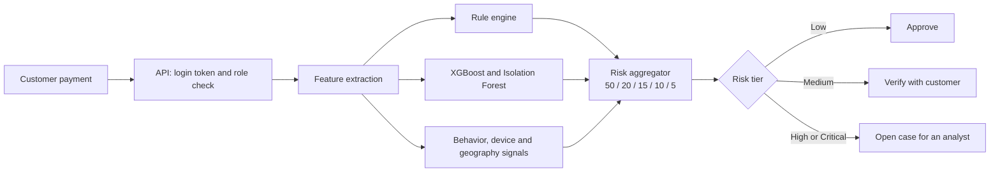
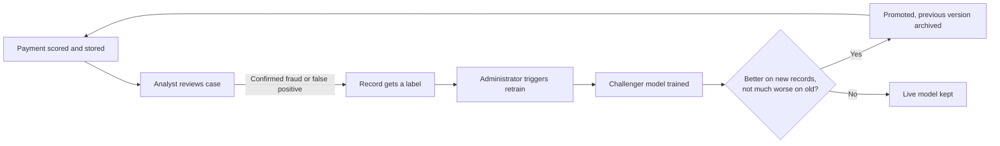

# Architecture

FinGuard is a React web console in front of a FastAPI service. The service scores payments, stores cases and decisions in SQLite, and serves the trained models.

## How a payment is scored

## Components

| Layer | What it is | Where |
|---|---|---|
| Web console | React and Vite, one page for the public site and a role-based console | `src/frontend/` |
| API | FastAPI with JWT login and role checks on every route | `src/backend/main.py`, `auth.py` |
| Detection | Features, rules, model inference, aggregator, explanations, retraining | `src/backend/detection/` |
| Storage | SQLite: users, cases, audit log, transactions, model versions | `src/backend/db.py` |
| Training | Script that trains XGBoost and Isolation Forest and saves them | `src/ml/train.py` |

## Risk score

The final score is a weighted sum of five signals, each scaled from 0 to 100.

| Signal | Weight | Source |
|---|---|---|
| ML model | 50% | 80% XGBoost fraud probability and 20% Isolation Forest anomaly score |
| Rules | 20% | Thresholds on amount, hour, foreign use, location, device trust and velocity |
| Behavior | 15% | Transactions in the last 24 hours and night-time activity |
| Device | 10% | Inverse of the device trust score |
| Geography | 5% | Foreign transaction and billing/transaction location mismatch |

| Score | Tier | Action |
|---|---|---|
| 0 to 30 | Low | Approve automatically |
| 31 to 60 | Medium | Verify with the customer and keep monitoring |
| 61 to 80 | High | Hold the transaction and alert an analyst |
| 81 to 100 | Critical | Block and open an investigation case |

!!! warning "Illustrative weights"
    The weights are a design choice and have not been calibrated against live data. A production system would tune them.

## Roles

| Role | Can do |
|---|---|
| Customer | Make payments and see the status of their own cases |
| Fraud Analyst | Review the case queue and record decisions. The only role that can decide |
| Risk Manager | Read the queue, use the score tool, view the audit log and model status |
| Administrator | Read the queue and audit log, view model status, retrain and manage models |

The role is never taken from the browser. A signed token names the user, and the server looks the role up in the database on every request.

## Continuous learning

## Data stored

| Table | Holds |
|---|---|
| `users` | Username, role, salted password hash |
| `cases` | Flagged payments waiting for or past review |
| `audit` | Every decision with the role that made it and the time |
| `transactions` | Every scored payment with its features and, once reviewed, a label |
| `model_versions` | Every retraining attempt with its metrics and outcome |

## Proposed design and what was built

The project proposal described a larger platform. The prototype keeps the same ideas in a smaller form.

| Proposal | Prototype | Why |
|---|---|---|
| Node/Express services plus FastAPI | One FastAPI service | One service covers the scope and is easier to test |
| PostgreSQL or MongoDB, Redis | SQLite | No external services to install |
| Message queue and Kafka streaming | Direct scoring in the request | Not needed at prototype volume |
| Prometheus and Grafana | Test suite and stored model metrics | Monitoring belongs with deployment |
| Graph fraud rings, LLM-assisted investigation | Not built | Listed as future work |