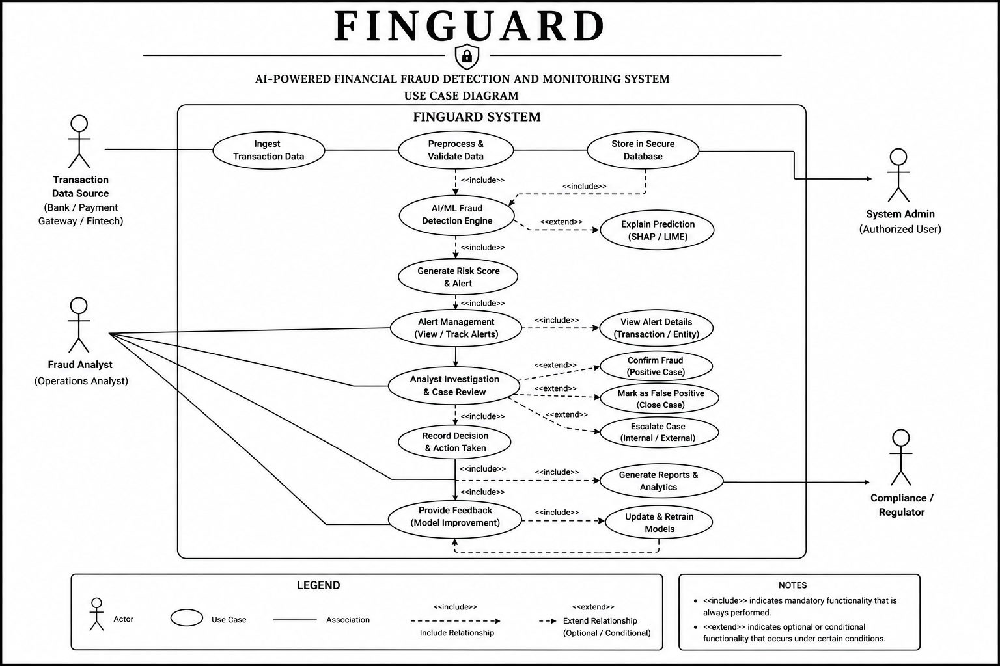
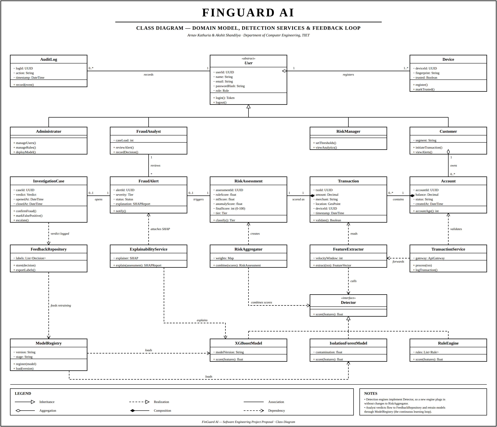
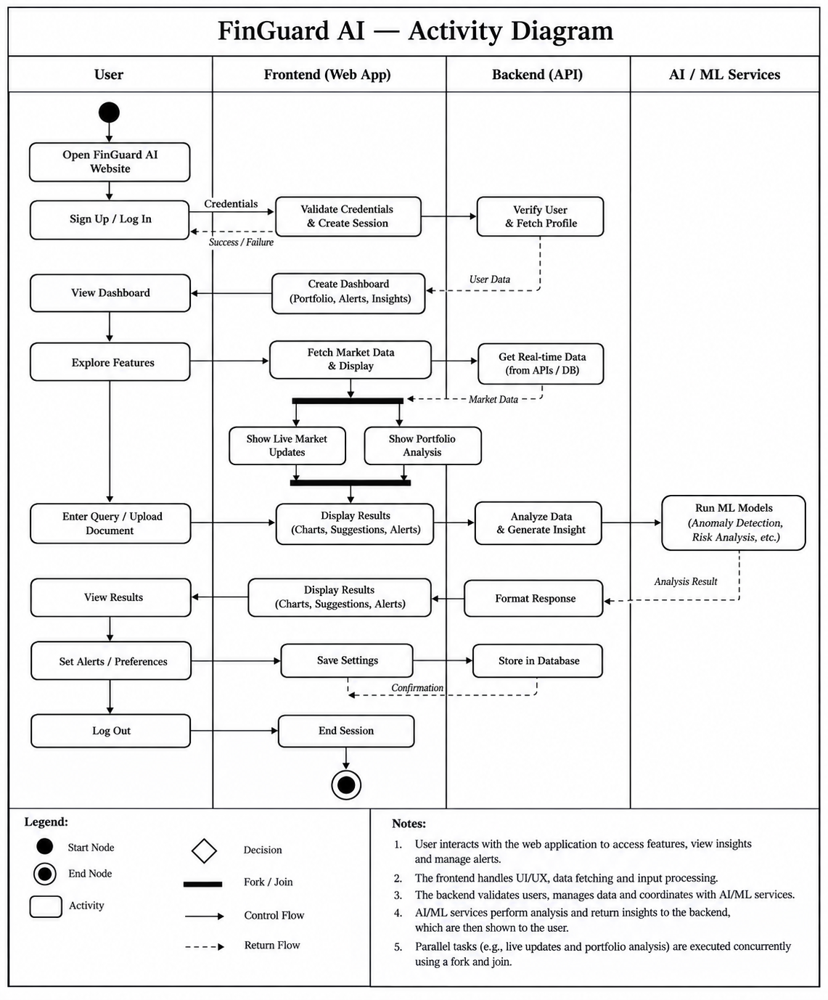
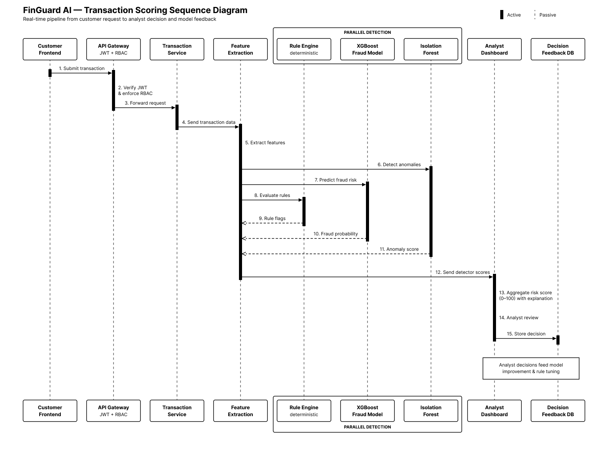
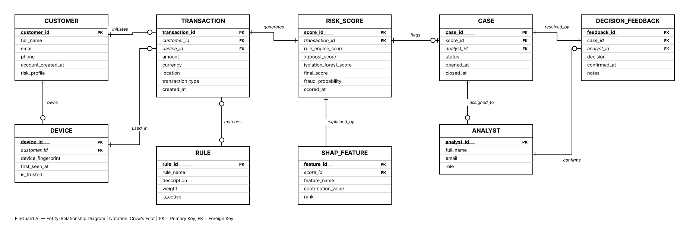
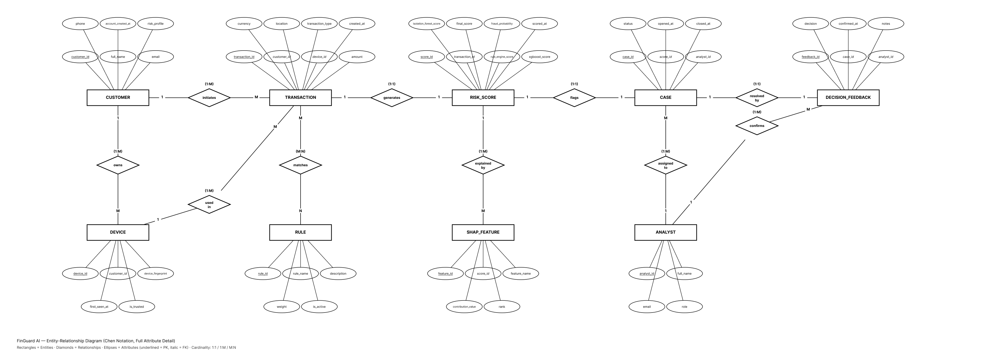
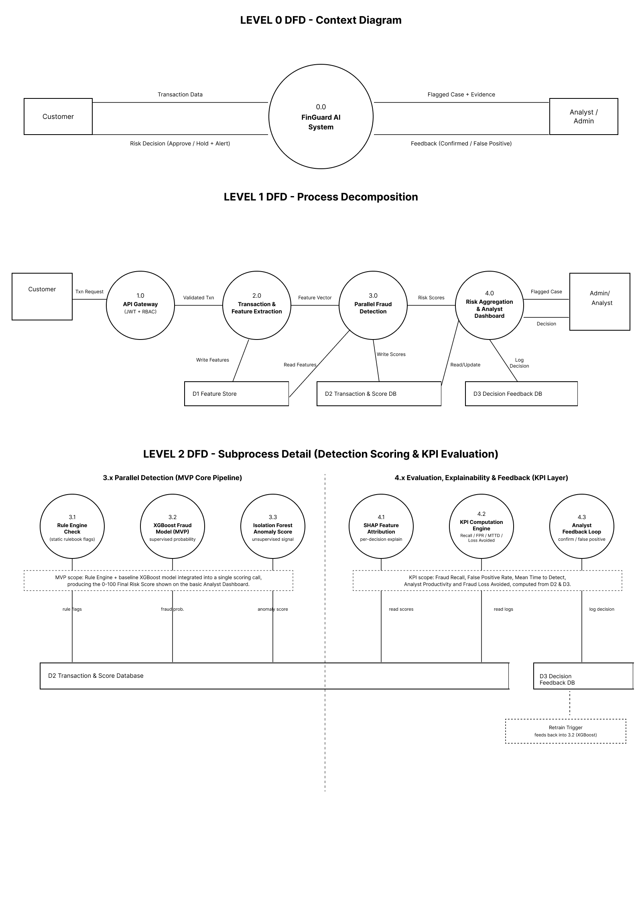

# Diagrams

## Use case diagram

Who uses the system and what each role can do.

## Class diagram

The domain model, the detection services and the feedback loop.

## Activity diagram

The workflow of a transaction through the system.

## Sequence diagram

How the parts of the system interact over time.

## Entity-relationship diagram

The data stored by the system, in two parts.

## System flow

The path of a transaction from the customer to the analyst's decision and back into retraining.

